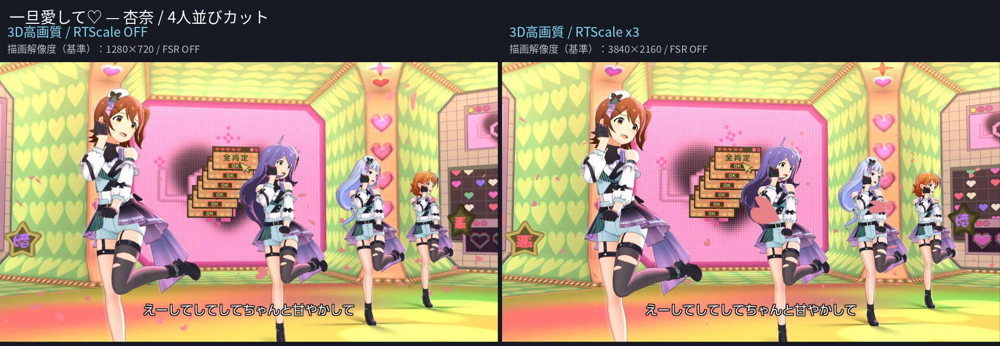
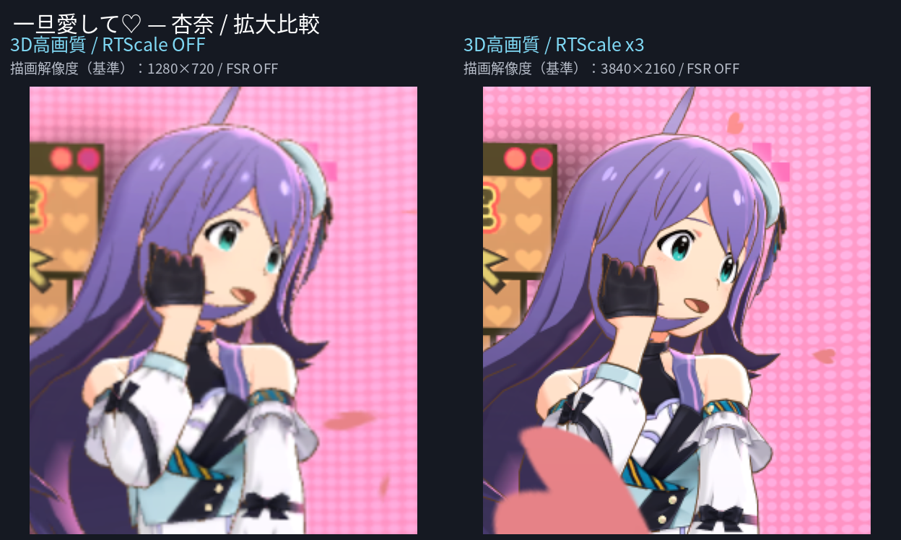
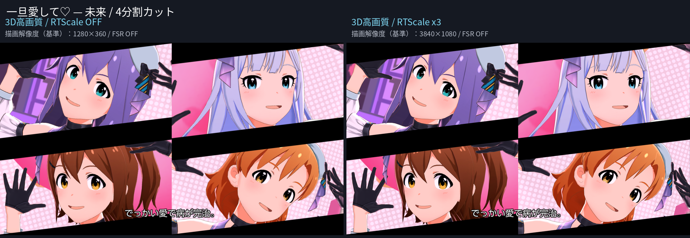
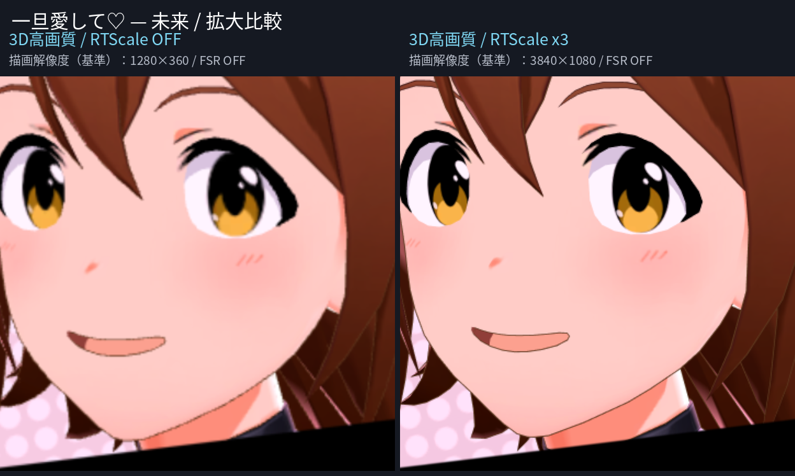
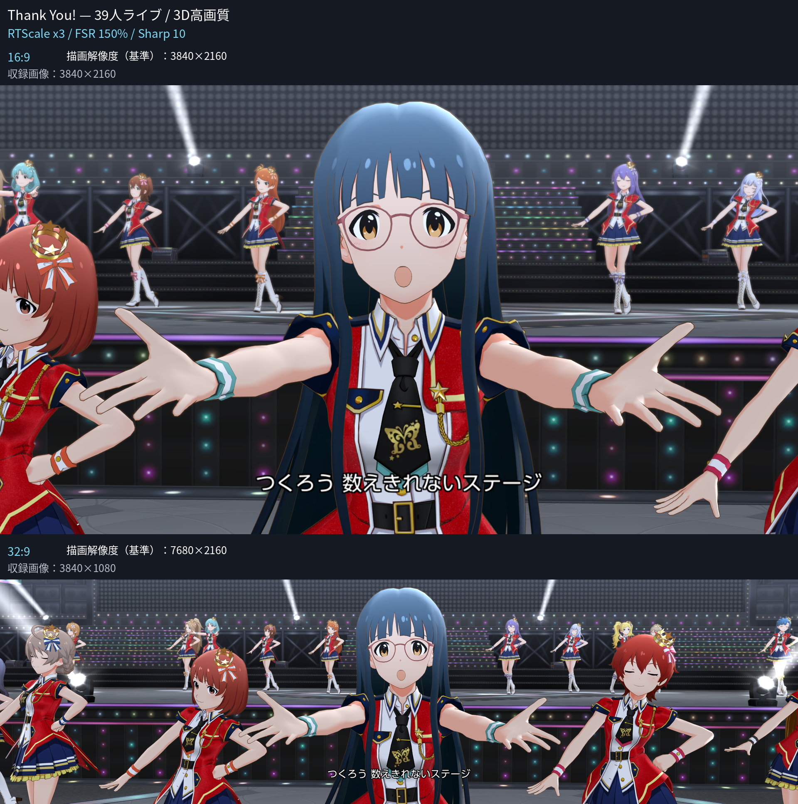

# MLTD Waydroid Manager (MWM)

Linux + AMD GPU環境で「アイドルマスター ミリオンライブ！ シアターデイズ（以下、ミリシタ）」を高解像度描画するためのプロジェクトです。本ツールはChatGPTおよびCodexを用いて作成・改修し、CachyOSでの実機検証を重ねて開発しています。

## 謝辞

Mesa GLES Render Scale（以下、RTScale）の技術情報を公開した[mogareta7731氏](https://zenn.dev/mogareta7731)、ならびにMesa・Waydroid・Gamescope・MangoHudなどの開発者に感謝します。

MWMで使用するRTScaleは、mogareta7731氏が公開した技術情報をもとに独立実装したものです。

- [Mesa GLES Render Scale（Render Target Scale）について - note](https://note.com/mogareta7731/n/n4db668be92b5)
- [Mesa GLES Render Scaleの利用例 - note](https://note.com/mogareta7731/n/n80aebd523379)

## 免責事項

MWMはミリシタの権利者および各ソフトウェアの開発元とは関係のない非公式ツールです。WaydroidおよびGamescopeの描画・表示設定などを調整するもので、APKやゲームデータを改変せず、チートなどの不正行為を目的としたものではありません。

利用規約を確認のうえご自身の判断でご利用ください。利用に伴う不具合、データ消失、アカウントへの影響などについて、作者は法令上許容される範囲で責任を負いません。

## 描画比較

Gamescopeで撮影した実機MVです。以下は縮小プレビューです。

同じ編成・衣装・画質と近いカメラ・ポーズを合わせていますが、別再生のため髪・衣装・紙吹雪などに微小な時間差があります。

### 一旦愛して♡ — 3D高画質

4人並びカット

4分割カット

### Thank You! — 39人ライブ / 3D高画質

16:9と32:9の比較（RTScale x3 / FSR 150% / Sharp 10）

[原寸PNG・比較画像一式（ZIP）](https://github.com/relorah/mltd-waydroid-manager/releases/download/v0.91/MWM_README_Comparisons_20261017.zip)

画像内のゲーム・キャラクター等の権利は各権利者に帰属します。

## 主な機能

- RTScaleによる内部描画解像度の高倍率化
- AMD FSR1によるアップスケーリングとシャープニング
- 描画アスペクト比の設定
- マウス操作のタッチ入力化
- FPS・CPU／GPU使用率などの表示
- RTScale Zoom Fixによる過度な拡大・描画ずれへの互換対応

## 使用技術

- CachyOS / Waydroid（Android 11）
- Mesa GLES Render Scale（RTScale）とMWM独立実装
- Gamescope / AMD FSR1
- 独自実装のMWM HUD / MangoHud（MangoApp）

## テスト環境

- **CPU**：AMD Ryzen 7 9700X
- **GPU**：AMD Radeon RX 6600 XT / RX 9060 XT 8GB
- **AMD BC250**：8コア16スレッド、GPU 24 CU / 40 CU構成
- **Display**：1920×1080 120Hz / 3840×2160 120Hz
- **OS**：CachyOS

## 導入と設定

インストールや更新、使い方などは[docs/SETUP.md](docs/SETUP.md)を参照してください。

## 開発状況

実験的な開発中のツールです。
