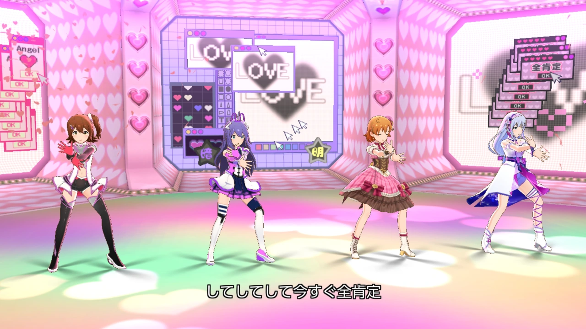
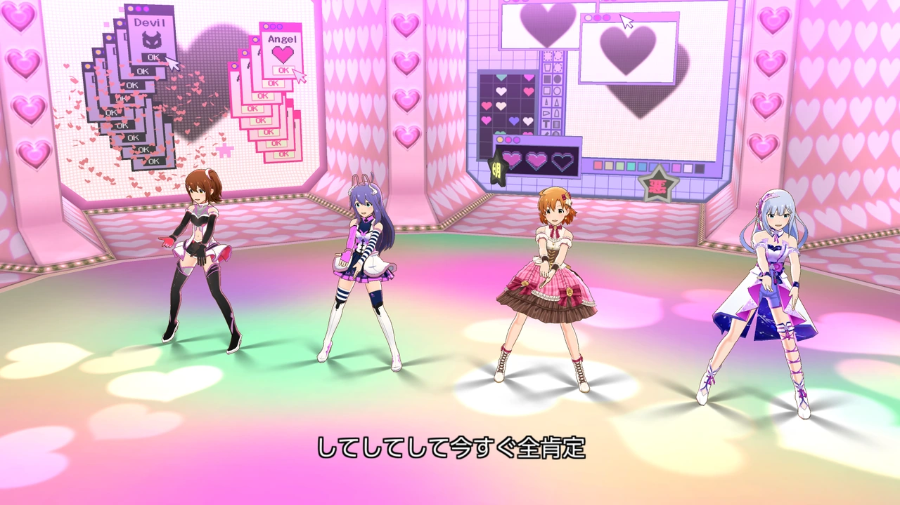
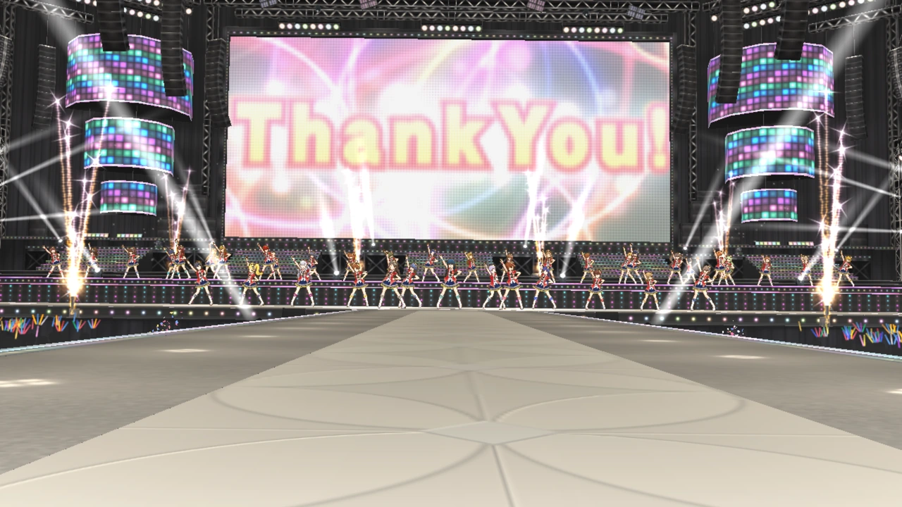
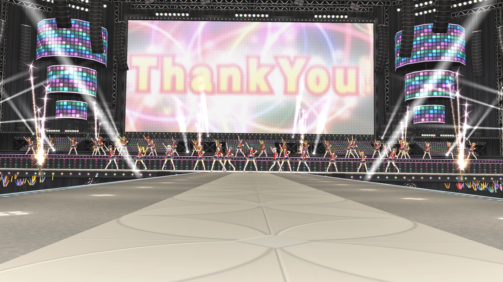
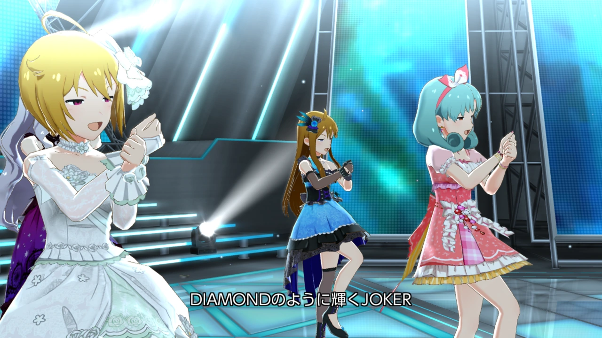

# MLTD Waydroid Manager (MWM)

CachyOS + AMD GPU環境で「アイドルマスター ミリオンライブ！ シアターデイズ（以下、ミリシタ）」を高解像度描画するためのプロジェクトです。本ツールはChatGPTおよびCodexを用いて作成・改修し、コード確認と実機検証を重ねて開発しています。

## 謝辞

Mesa GLES Render Scale（以下、RTScale）の技術情報を公開した[mogareta7731氏](https://zenn.dev/mogareta7731)、ならびにMesa・Waydroid・Gamescope・MangoHudなどの開発者に感謝します。

RTScaleはmogareta7731氏が公開した技術情報を参考に、Waydroid向けに独立実装・調整しています。

- [Mesa GLES Render Scale（Render Target Scale）について - note](https://note.com/mogareta7731/n/n4db668be92b5)
- [Mesa GLES Render Scaleの利用例 - note](https://note.com/mogareta7731/n/n80aebd523379)

## 免責事項

MWMはミリシタの権利者および各ソフトウェアの開発元とは関係のない非公式ツールです。利用規約を確認のうえ、ご自身の判断でご利用ください。利用に伴う不具合、データ消失、アカウントへの影響などについて、作者は法令上許容される範囲で責任を負いません。

## 描画比較

Gamescope・表示1920×1080・FSR OFFで撮影した実機MVです。同じ画質・ユニット・衣装でRTScale OFFとx3を比較しています。画像は1280×720のプレビューで、カメラ位置やポーズは完全には同期していません。性能測定ではなく見た目の参考です。

### 3D標準：一旦愛して♡

| RTScale OFF | RTScale x3 |
| --- | --- |
|  |  |

### 3D標準：Thank You! 39人ライブ
| RTScale OFF | RTScale x3 |
| --- | --- |
|  |  |

### 3D高画質：DIAMOND JOKER

| RTScale OFF | RTScale x3 |
| --- | --- |
|  |  |

画像内のゲーム・キャラクター等の権利は各権利者に帰属します。

## 主な機能

- RTScaleによる内部描画解像度の高倍率化
- AMD FSR1によるアップスケーリングとシャープニング
- 描画アスペクト比の設定
- マウス操作のタッチ入力化
- FPS・CPU／GPU使用率などの表示
- RTScale Zoom Fixによる過度な拡大・描画ずれへの互換対応

## 使用技術

- CachyOS / Waydroid（Android 11）
- Mesa GLES Render Scale（RTScale）とMWM独立実装
- Gamescope / AMD FSR1
- 独自実装のMWM HUD / MangoHud（MangoApp）

## テスト環境

- **CPU**：AMD Ryzen 7 9700X
- **GPU**：AMD Radeon RX 6600 XT / RX 9060 XT 8GB
- **AMD BC250**：8コア16スレッド、GPU 24 CU / 40 CU構成
- **Display**：1920×1080 120Hz / 3840×2160 120Hz
- **OS**：CachyOS

## 導入と設定

インストール、更新、各設定の使い方、バックアップとアンインストールは[docs/SETUP.md](docs/SETUP.md)を参照してください。

## 開発状況

実験的な開発中のツールです。
